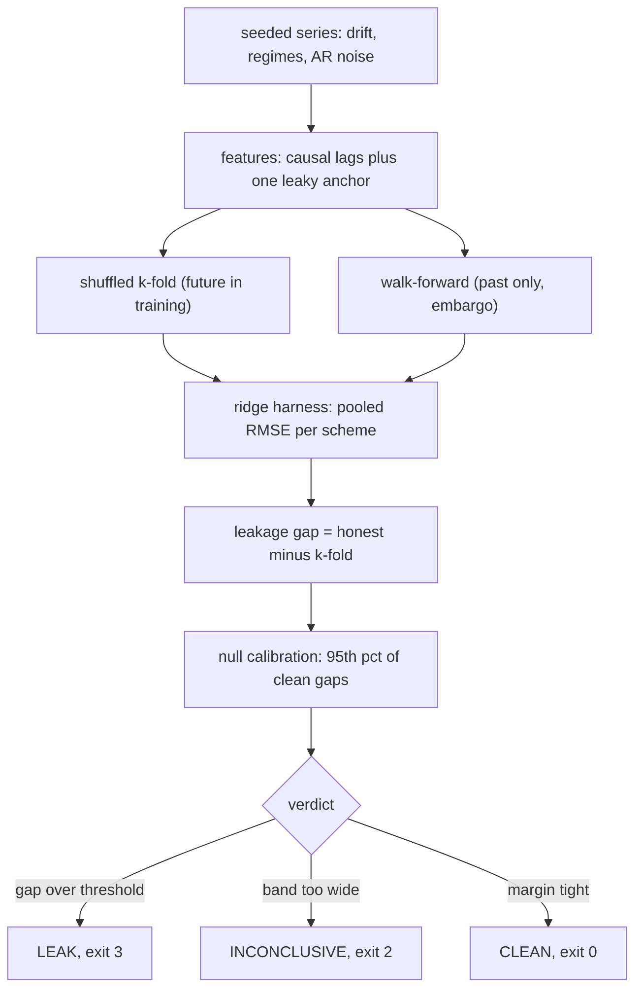
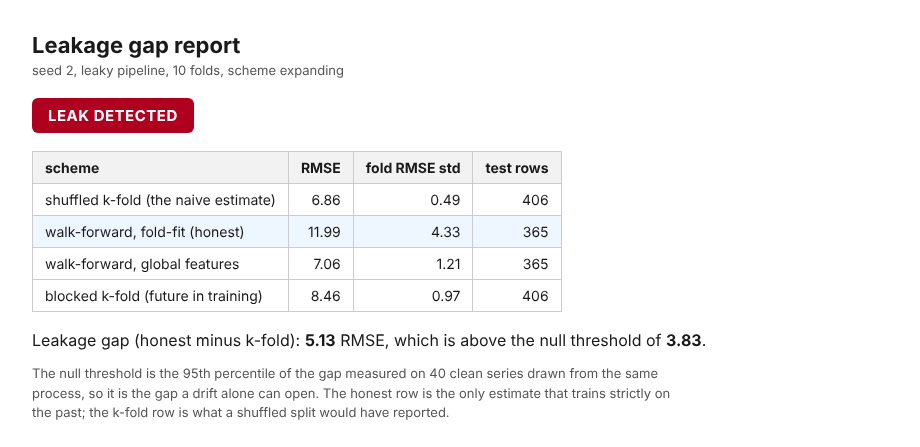

<div align="center">

# forecast-backtest-leakage

**Scores the same forecasting pipeline with shuffled k-fold and with a time-ordered walk-forward backtest, and reports the gap between them as a calibrated leakage signal.**


</div>

## The question a k-fold score cannot answer

Random k-fold cross validation is the default way a forecaster is validated before it
ships. On a time series it is structurally blind to look-ahead leakage, and not by a
little. Shuffling the rows puts future rows into the training fold of every split, so the
model is fitted with access to the future of the very points it is scored on. A leak does
not lower the k-fold score, it is rewarded by it.

Three questions this answers that a k-fold score cannot:

1. How much of your reported accuracy is the model seeing the future, rather than
   predicting it?
2. Is a worse walk-forward score evidence of a leak, or just of a series that drifts?
3. At your backtest length, how small a leak could be hiding under a clean-looking score?

## The uncomfortable numbers, first

On a corpus of 40 clean series, with a leak injected as one future-aware feature:

- Shuffled k-fold **rates it 6.9** RMSE, which is *better* than the **clean pipeline's
  7.2**. The leak does not just pass the gate, it wins the gate.
- That same leaked pipeline's **true error is 13.5** RMSE under an honest walk-forward
  backtest, which k-fold **understates by 96%**.
- k-fold scores the clean and leaked pipelines **within 5%** of each other, so it cannot
  rank one above the other, while the honest error is **58% worse** on the leak.

And the number that keeps the tool honest about itself: a clean, leak-free pipeline can
open a gap **as large as 11.8** RMSE purely from non-stationarity, larger than the typical
gap of a real leak. That is why the gap is calibrated against a null rather than
thresholded at zero.

Every figure in this document is re-measured from the code by `tools/collect_metrics.py`
and held to the prose by `tools/check_numbers.py` in CI. The suite is **66 tests** at
**100% line coverage**.

## Quickstart

Prerequisites: Python (`3.11`, `3.12` or `3.13`) and pip. No API keys, no network at runtime.

```bash
pip install -e .

# Score the leaky pipeline on one fixture series and print the gap and verdict.
btleak --seed 2 --leaky

# The honest comparison: the strictly causal pipeline on the same series.
btleak --seed 2 --clean

# Re-measure every published number from scratch, offline, and verify the docs.
make verify
```

`make verify` runs lint, the test suite, re-measures the experiments, and fails if any
number in this README or the ADRs has drifted from the code. It passes from a fresh clone
with no network.

## What each scheme reports

The core move is to run four schemes that share the same fold boundaries and the same
model, so the only thing that varies is the protocol. The honest row is the one that trains
strictly on the past.

```text
scheme                             what it allows                     role
---------------------------------  ---------------------------------  ----------------------
shuffled k-fold (fold-fit)         future rows in every training fold the naive estimate
walk-forward, fold-fit             only the past (honest)             the truth
walk-forward, global features      a transform fit on all rows        isolates feature leak
blocked k-fold                     future blocks, test rows contiguous isolates membership leak
```

The **leakage gap** is the honest walk-forward error minus the k-fold estimate. On the leak
it is large and positive; the clean pipeline honestly scores 8.5 RMSE against a k-fold
estimate close behind it.

## Is the gap a leak, or just a drift?

A non-stationary series opens a gap with no leak at all, because a time-ordered backtest
trains on less and meets regime shifts the past cannot see. So the gap is calibrated against
a null distribution estimated from clean series drawn from the same process. The threshold
is the 95th percentile of the clean gap, a null **threshold of 3.8** RMSE here. The
false-alarm rate is measured on a held-out block of clean series, disjoint from the ones
that set the threshold.

| measurement | result | what it buys / costs |
| --- | --- | --- |
| detection on seeded leaks | catches **100% of the seeded leaks** | the ordering buys leak detection |
| false alarm on clean series | below **one in 40** held-out series | priced at the resolution floor, not zero |
| largest clean gap, no leak | **as large as 11.8** RMSE | the confound the null exists to absorb |

A measured zero false alarm is reported as "below one in 40", its resolution floor, never
as zero: zero over 40 is a statement about the sample size, not a property of the detector.

## Two leaks, two channels

The gap has two independent sources, and the fix differs for each. Decomposed over the
corpus:

- **54% survives** a time-ordered split: this is feature-fit leakage, a transform fit on
  all rows, and ordering the split does not remove it. Fitting per fold does.
- **46% from letting** the future into training: this is membership leakage, the thing a
  shuffle adds, and only an ordered split removes it.

A tool that ordered the split but still fit features globally would close one door and
leave the other open. This is why the pipeline fits per fold *and* orders the split.

## The bugs the measurement found

**The anchor that collapsed into a global mean.** The first level-anchor feature used a
fixed calendar window and fell back to the mean of all available rows when a wide test
block left a row with no in-window past. On seed 0 that pushed the honest leaky error to
`26.2` RMSE, roughly triple the clean error, so the gap looked huge for the wrong reason: a
degenerate feature, not a leak. Anchoring on the nearest available rows instead kept it a
proper trailing mean and brought the honest error to about 11.4 RMSE. Pinned by
`test_the_honest_leaky_error_stays_in_a_believable_range`; written up in
[ADR 003](docs/adr/ADR-003-gap-statistic-and-null-calibration.md).

**The false-alarm rate that was measured on its own threshold.** An early version set the
threshold on a block of clean series and then measured the false-alarm rate on the same
block, which by construction returns exactly the complement of the percentile and measures
nothing. The calibration and evaluation seed blocks are now disjoint; see
[ADR 005](docs/adr/ADR-005-synthetic-deterministic-fixture.md).

## Architecture



<details>
<summary>diagram source</summary>



</details>

## Evidence



Generated by `tools/capture_screenshots.py` from the real report the CLI writes; the script
fails if the verdict badge is not legible, so this image cannot show a badge that would be
invisible in the product.


A replay of captured stdout, paced by each command's measured wall time, not a hand-written
mock-up. Every command and its exit code is listed in
[`docs/video/manifest.json`](docs/video/manifest.json).

## The corpus

The fixture is a seeded synthetic daily demand series: a drifting level with periodic regime
shifts, a weekly seasonal shape, and autoregressive noise. It is synthetic on purpose,
because measuring a leak detector needs a ground-truth switch for the leak that no real
dataset gives. The awkward cases it deliberately contains:

- Clean series whose drift alone opens a large gap, up to 11.8 RMSE, so the false-alarm
  rate is measured against genuine confounds, not easy negatives.
- The non-stationarity is tuned high enough that a trailing feature lags the level, which is
  what makes the leak worth something and the null non-trivial.

Figures are measured over 40 clean series for calibration, with disjoint seed blocks for
clean and leaked evaluation.

## What this cannot measure

This is the honest boundary, and it is the strongest part of the design.

- **It cannot certify a clean pipeline at this backtest length.** The band margin, the
  smallest leak the backtest can resolve, stays **never below 0.9** RMSE anywhere from ten
  up to 20 folds, which is still **18 times the smallest** leak worth catching (0.05 RMSE).
  So a below-threshold gap returns "inconclusive", not "clean". A short, serially correlated
  backtest cannot prove a negative, and the tool says so.
- **It cannot catch a feature that is non-causal by construction.** The gap measures leakage
  that lives in the protocol, the split or a global fit. A feature whose own definition
  reads the future and is computed identically in train and test, such as a centred rolling
  mean, leaks in both schemes and so opens no gap. That is a feature-engineering bug, out of
  scope here; see [ADR 002](docs/adr/ADR-002-fold-fit-features.md).
- **The detection and false-alarm rates are facts about this process.** They depend on how
  non-stationary the series is and how large the leak is. The mechanism transfers to real
  data; the specific rates do not. The one claim that genuinely needs real data, that these
  rates hold on production demand, is out of reach of a synthetic fixture.

## Layout, exit codes, reproduction

```text
src/backtest_leakage/   config, generator, features, splitters, harness, gap, report, cli
tests/                  66 property-named tests, including the war-story regression
experiments/            four experiments writing JSON to docs/experiments/
tools/                  collect_metrics, check_numbers, render_diagrams, capture_screenshots, record_demo
docs/adr/               five architecture decision records
policy.toml             every threshold and window, commented, loaded via tomllib
```

Exit codes make the CLI usable as a gate, and separate the two answers a naive check
conflates:

```text
0  no leak the backtest could resolve (clean)
2  inconclusive: gap under threshold, but the band is too wide to rule a leak out
3  leak detected: gap above the null threshold
1  usage or runtime error (the tool failed to answer)
```

Reproduce every number with `make verify`. The number checker matches anchor phrases, not
bare digits, so it catches a stale sentence around a correct value and survives a figure
that reads differently in a table and a paragraph.

## Tech stack

| Technology | Role here | Why this one |
| --- | --- | --- |
| numpy | series generation, pooling, percentiles | exact, seeded, reproducible arithmetic with no runtime services |
| pandas | tabular handling at the edges | the lingua franca a reviewer expects for a demand series |
| scikit-learn | ridge model and feature scaling | a deliberately dull, deterministic estimator (ADR 004) so the gap is attributable to the protocol |
| scipy | distribution helpers behind the null | standard, well tested statistics rather than hand-rolled ones |
| tomllib (stdlib) | reads policy.toml | configuration without adding a dependency |
| ruff, pytest | lint and test, line length 100 | fast, and the receipts depend on a clean test report |

## The ADRs

- [ADR 001: Walk-forward with an expanding window is the honest estimator](docs/adr/ADR-001-walk-forward-as-the-honest-estimator.md)
- [ADR 002: Features are fit per fold, and the one leaky feature is explicit](docs/adr/ADR-002-fold-fit-features.md)
- [ADR 003: The gap is calibrated against a non-stationarity null](docs/adr/ADR-003-gap-statistic-and-null-calibration.md)
- [ADR 004: A deliberately dull model](docs/adr/ADR-004-a-deliberately-dull-model.md)
- [ADR 005: A seeded synthetic fixture, and what it cannot stand in for](docs/adr/ADR-005-synthetic-deterministic-fixture.md)

## The Pivot and future work

Out of scope by choice: a block-bootstrap confidence interval on the walk-forward error,
which would put a calibrated band around the honest estimate itself rather than a point
gap. Trigger to add it: the first time a user needs to report the honest error with an
interval, not just a leak verdict.

A v2 would want: a real demand dataset as a second fixture to study transfer (the first
metric to watch is whether the null band widens on real non-stationarity); a purged,
embargoed k-fold as a third scheme; and a panel of related series so the null can be
estimated per series rather than per process.
